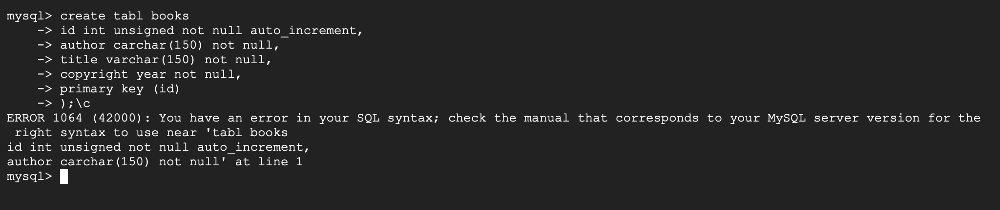
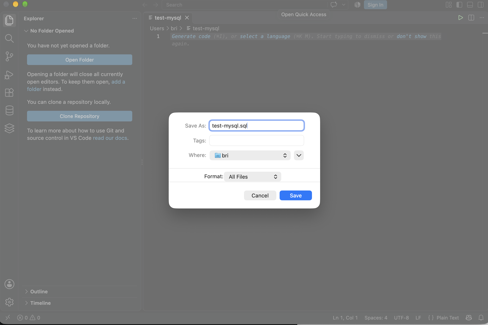
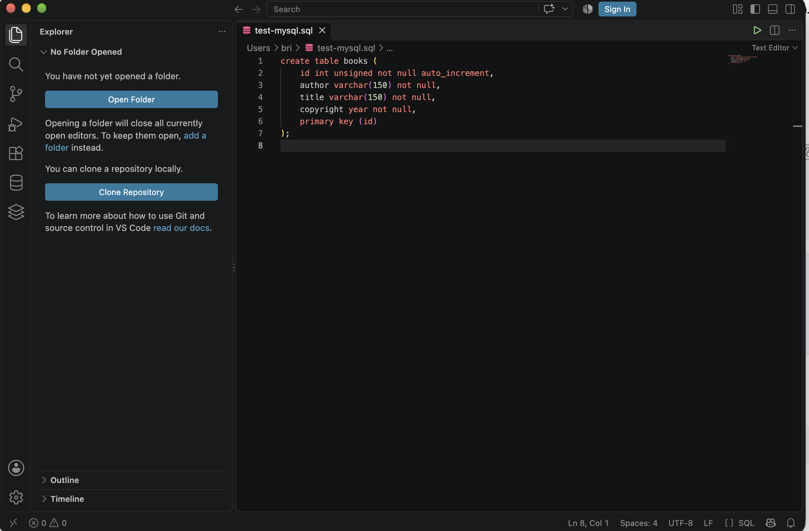

# Fix typing errors in the MySQL terminal

This document outlines how to recover from typing mistakes in the MySQL CLI. It also shows how to prevent these mistakes.

## The problem

You type a multi-line statement directly into the `mysql>` prompt. You make a typing error. You cannot move the cursor up to a previous line. You think you must close the terminal and start again.

You do not need to do this. Use the solutions in this guide to leave the statement and keep your session open.

## How the MySQL client reads your typing

The MySQL client does not run a statement when you press Enter. It runs the statement when it reads a semicolon (`;`). Until then, the client stores each line in a buffer and shows an opener on the next line that acts as a continuation point.

The opener tells you what the client is waiting for. Look at the prompt before you type.

| Prompt | Meaning |
|--------|---------|
| `mysql>` | The client is ready for a new statement. |
| `->` | The statement is not complete. The client waits for more lines or a semicolon. |
| `'>` | A single quote is open. The client waits for the closing quote. |
| `">` | A double quote is open. The client waits for the closing quote. |

## Example of the problem

The typed statement in this guide has two errors:

- `tabl` instead of `table`
- `carchar` instead of `varchar`


When you enter the semicolon, MySQL runs the statement and shows an error.



Error 1064 means MySQL found a syntax error. The message shows the text from the point where MySQL stopped reading. MySQL stops at the first error. It does not show the other errors.

## Solution 1: Cancel the statement with `\c`

Use this solution when the prompt is `->` and you find a typing error in a previous line. You have not yet typed the semicolon.

1. Type `\c`.
2. Press Enter.

The client clears the buffer. The `mysql>` prompt shows again. The session stays open.

3. Type the statement again, or paste it from your text editor.

> **Note:** Type `\c` before you type the semicolon. After the semicolon, MySQL has already run the statement. `\c` then has nothing to cancel. This is a mistake made in the second screenshot.

## Solution 2: Close an open quote, then cancel

Use this solution when the prompt is `'>`, `">`, or `` `> ``. In this state, MySQL reads `\c` as part of the text in the quote. The cancel command does not work until you close the quote.

1. Look at the prompt. Find the quote character that is open.
2. Type the same quote character.
3. Press Enter. The prompt changes to `->` or `mysql>`.
4. Type `\c`.
5. Press Enter.

The `mysql>` prompt shows again.

## Solution 3: Remove an object that you created with a typing error

Use this solution when the statement ran without an error, but the name is wrong. For example, you typed `create table boosk` instead of `create table books`. MySQL created a table with the wrong name.

1. Show the tables in the database:

   ```sql
   show tables;
   ```

2. Find the table with the wrong name.
3. Delete the table:

   ```sql
   drop table boosk;
   ```

4. Run the correct statement.

> **Warning:** `drop table` deletes the table and all data in it. Do not use it on a table that contains data you need.

## Prevent typing errors: write the statement in a file first

Typing in the MySQL terminal gives you no editor features. You cannot move between lines, and you get no help from the editor. While a text editor (e.g., NotePad or TextEdit) can provide some quality of life features, a more fully featured code editor, such as Visual Studio Code, provides tools for editing code, like MySQL.

1. Open a code or text editor editor. This guide uses Visual Studio Code.
2. Create a new file.
3. Save the file with the `.sql` extension, for example `test-mysql.sql`.

   

   One of the advantages of a code editor is that using the `.sql` extension makes the editor apply SQL syntax highlighting. The editor highlights SQL keywords in a different color, and therefore a misspelled keyword does not get the keyword color. Use this to find errors before you run the statement in the terminal.

4. Type the statement in the file.

   

5. Read the statement. Check each keyword, comma, parenthesis, and semicolon.
6. Select the complete statement and copy it.
7. Click in the terminal window.
8. Paste the statement.
9. Press Enter if the statement does not run automatically.

If MySQL shows an error, correct the statement in the file. Copy and paste it again. You keep a record of each version of the statement, and you do not need to type it again.

## Common typing errors

| Error | Example | Result |
|-------|---------|--------|
| Misspelled keyword | `create tabl books` | Error 1064 |
| Misspelled data type | `carchar(150)` | Error 1064 |
| Missing opening or closing parenthesis | `create table books` followed by column lines | Error 1064 |
| Missing comma between columns | `id int` followed by `author varchar(150)` on the next line | Error 1064 |
| Missing semicolon | `show tables` | The prompt changes to `->`. The statement does not run. |
| Missing closing quote | `'Dune` | The prompt changes to `'>`. The statement does not run. |

## Quick reference

| Situation | Action |
|-----------|--------|
| The prompt is `->` and you find an error | Type `\c` and press Enter. |
| The prompt is `'>`, `">`, or `` `> `` | Type the quote character, press Enter, type `\c`, and press Enter. |
| The statement ran and MySQL shows an error | Press the Up Arrow key, correct the statement, and press Enter. |
| The statement ran with a wrong name | Use `drop table` and run the correct statement. |
| You want to prevent all of these errors | Write the statement in a `.sql` file, then copy and paste it. |

## Related information

- [MySQL Reference Manual: mysql client commands](https://dev.mysql.com/doc/refman/8.0/en/mysql-commands.html)
